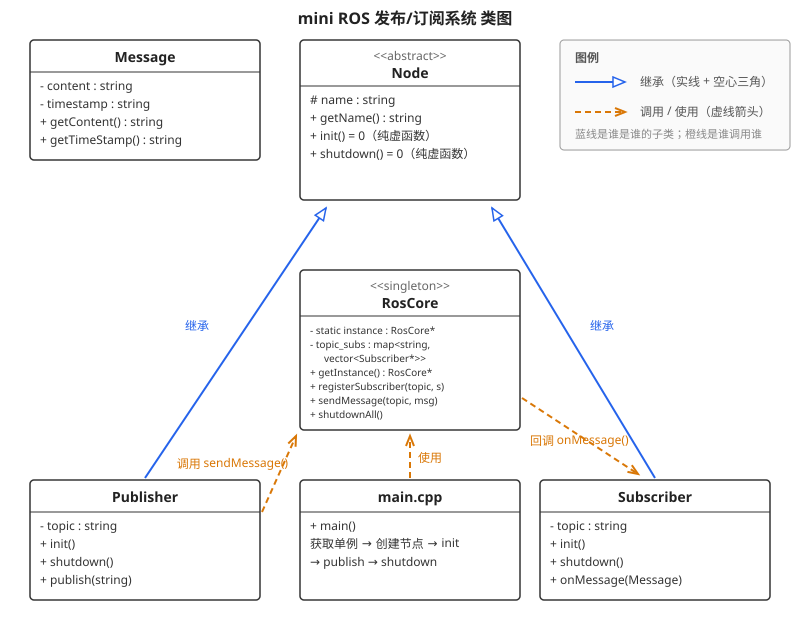

# 架构设计文档 —— C++ 模拟 ROS 发布/订阅通信系统

## 1. 总体结构

系统共 6 个模块，采用"自底向上"的依赖关系，每个模块只依赖它左边的模块：
main.cpp（测试入口）→ RosCore（单例核心）→ Publisher / Subscriber → Node（抽象基类）→ Message

## 2. 类图

文字补充说明：

- 模块依赖：main.cpp → RosCore（单例核心）→ Publisher / Subscriber → Node（抽象基类）→ Message
- 继承关系：Publisher 和 Subscriber 都继承自 Node
- 调用关系：
  - Publisher.publish() 构造 Message 后调用 RosCore.sendMessage()
  - RosCore.sendMessage() 遍历订阅者，回调 Subscriber.onMessage()
  - RosCore 持有 map<string, vector<Subscriber*>> 记录每个话题的订阅者

## 3. 类设计说明

### 3.1 Message
| 成员 | 说明 |
|------|------|
| `string content` | 消息内容，构造后不再修改 |
| `string timestamp` | 发送时间，构造函数内自动生成（YYYY-MM-DD HH:MM:SS） |
| `string getContent()` | 读取消息内容 |
| `string getTimeStamp()` | 读取时间戳 |

### 3.2 Node（抽象基类）
| 成员 | 说明 |
|------|------|
| `string name`（protected） | 节点唯一名称 |
| `Node(string name)` | 构造时校验名称非空，为空则抛异常 |
| `string getName()` | 只读访问节点名 |
| `virtual void init() = 0` | 纯虚函数：初始化，由子类实现 |
| `virtual void shutdown() = 0` | 纯虚函数：关闭，由子类实现 |

### 3.3 Publisher
| 成员 | 说明 |
|------|------|
| `string topic` | 所属话题 |
| `init()` | 向 RosCore 注册发布者，输出日志 |
| `shutdown()` | 输出关闭日志 |
| `publish(string msg_data)` | 构造 Message 对象，调用 RosCore 转发 |

### 3.4 Subscriber
| 成员 | 说明 |
|------|------|
| `string topic` | 订阅的话题 |
| `init()` | 向 RosCore 注册并订阅话题 |
| `shutdown()` | 输出关闭日志 |
| `onMessage(Message msg)` | 回调函数：打印消息内容与时间戳 |

### 3.5 RosCore（单例）
| 成员 | 说明 |
|------|------|
| `static RosCore* instance` | 唯一实例指针 |
| `map<string, vector<Subscriber*>> topic_subs` | 话题到订阅者列表的映射 |
| `static RosCore* getInstance()` | 获取单例，首次调用时创建 |
| `registerSubscriber(string topic, Subscriber* s)` | 注册订阅者，重复注册抛异常 |
| `sendMessage(string topic, Message msg)` | 遍历该话题订阅者，逐个调用 onMessage |
| `shutdownAll()` | 遍历关闭所有节点 |

### 3.6 main.cpp
测试流程：获取 RosCore 单例 → 创建发布者和两个订阅者（话题 "/chatter"）→
依次 init() → 发布者发送两条消息 → 验证两个订阅者都收到 → RosCore 统一 shutdown()。

## 4. 关键设计决策

1. **为什么用纯虚函数**：Node 是对"节点"的抽象描述，没有统一的初始化逻辑，
   具体行为必须由 Publisher/Subscriber 各自实现，所以用纯虚函数强制子类实现接口。
2. **为什么基础版只存订阅者不存发布者**：消息转发的依据是"话题有哪些订阅者"，
   发布者只需在 init 时完成注册校验，不需要被核心长期持有，可以简化数据结构。
3. **为什么用 map<string, vector<Subscriber*>>**：话题名作为键可以快速定位订阅者列表；
   一个话题允许多个订阅者，所以值是 vector；存指针是为了利用多态调用子类的 onMessage。
4. **为什么用单例**：整个程序只需要一个消息转发的管理者，多处代码要访问它，
   单例保证全局只有一份实例、一份订阅表。